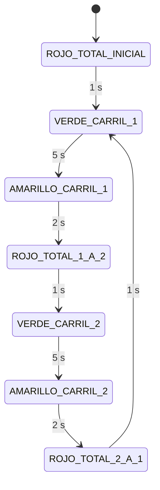

# ESP32-C6: dos semáforos en demostración autónoma

ESP-IDF nativo v6.0.2, C y FreeRTOS. Conserva el modo convencional 5/2/1 s y añade
[prioridad adaptativa simulada de tarea 06](PRIORIDAD06.md), verde 5..13 s con
alternancia obligatoria y despejes completos. El inicio mantiene ambos rojos 1 s.
No hay UDP, Wi-Fi de C6 ni conexión a YOLO. No cambia la cámara.

## Placa y cableado provisionales

La placa exacta **no está confirmada**. Comprobar esquema y variante del chip
antes de conectar. El firmware no habilita las salidas hasta confirmar el pinout
en menuconfig, menú «Semaforos - demostracion autonoma». Sin esa opción informa
el motivo y termina la tarea; **no promete ambos rojos en ese caso**.

| Carril | Rojo | Amarillo | Verde |
| --- | --- | --- | --- |
| 1 | GPIO2 | GPIO3 | GPIO10 |
| 2 | GPIO11 | GPIO18 | GPIO19 |

Cada GPIO → resistencia individual de **330 Ω** → ánodo LED; cátodo a GND común.
LED activo alto. No compartir una sola resistencia para varios LEDs. Confirmar
tensión, polaridad y límites de corriente del chip/placa antes de energizar.

Todos los pines están en main/semaforo_pinout.h. El validador usa la macro oficial
GPIO_IS_VALID_OUTPUT_GPIO y rechaza duplicados, arranque 4/5/8/9/15, USB 12/13,
UART 16/17 y flash 24..30. Esto no prueba disponibilidad en la placa: variantes
con flash SiP pueden **no exponer GPIO10/11**, y las conexiones internas del módulo
también importan. Si no existen, elegir salidas libres según el esquema y cambiar
el encabezado; no sustituirlas por un pin reservado para conservar el ejemplo.

## Arquitectura

- controlador_semaforos.c: lógica pura con tiempos monotónicos en ms; no usa GPIO.
- semaforo_gpio.c: única aplicación de luces, validación e intentos de estado seguro.
- semaforo_gpio_idf.c: adaptador al driver GPIO oficial; operaciones sustituibles en pruebas.
- main.c: tarea propietaria; ninguna otra tarea/interrupción escribe GPIO.
- demanda_vehicular.h: N1/N2, secuencia uint64, validez y recepción local.
- simulador_demanda.c: tarea opcional que escribe en una cola de longitud uno.



Los parámetros están centralizados en Kconfig; verdes iniciales 5000 ms, amarillo
2000 ms y rojo total 1000 ms. La tarea espera 20 ms con vTaskDelay, sin espera
activa. Consulta esp_timer_get_time y solo avanza **una fase** por actualización.
Tras aplicar GPIO fija de nuevo el inicio real de la fase: un retraso de
planificación prolonga la fase, nunca recorta amarillo/rojo para recuperar tiempo.

La revisión de GPIO conserva el rojo contrario y solo escribe niveles que cambian.
Apaga luces incompatibles, asegura primero los rojos necesarios, retira el rojo
del carril que abre y luego habilita su amarillo/verde. Las pruebas revisan cada
escritura y fallos en todas las transiciones entre estados.

Al iniciar se precargan registros con verdes/amarillos bajos y rojos altos antes
de habilitar salidas. En cada cambio se apagan primero ambos verdes, luego el
resto incompatible, y se enciende la luz deseada por carril sin quitar el rojo contrario. Hay un intervalo breve apagado
durante las escrituras; en los estados estables cada semáforo tiene exactamente
una luz y nunca ambos verdes. No hay escrituras atómicas de seis pines.

Ante fallo detectable se intentan **todas** las escrituras para apagar verdes y
amarillos y activar ambos rojos, aunque alguna falle; se bloquea el driver y se
detienen transiciones. Fallos de memoria/tareas después de habilitar GPIO también
intentan rojo seguro. Un estado lógico corrupto o reloj que retrocede pasa a
ESTADO_SEGURO. controlador_solicitar_seguro prepara una salida controlada:
verde→amarillo completo→rojo total completo→ESTADO_SEGURO. Un error GPIO usa la
acción inmediata de apagar verdes porque ya no puede confiar en las fases físicas.

El software no garantiza LEDs durante reset, arranque previo a app_main, pérdida
de alimentación, cables rotos, cortocircuitos o transistores dañados. No se desactiva
watchdog ni brownout. Esto es una maqueta educativa, con verificación física pendiente.

## Demanda simulada

Habilitar SEMAFORO_SIMULAR_DEMANDA en menuconfig para recorrer los escenarios reproducibles.
La cola usa xQueueOverwrite y conserva solo el último valor. El propietario valida
0..1000 vehículos, validez, secuencia estrictamente creciente y edad local ≤5 s,
sin timestamps futuros. La secuencia no se reinicia durante el mismo arranque;
antes de un futuro protocolo habrá que definir reinicios, sesiones y wrap-around.
En modo convencional no alteran los tiempos; en adaptativo se usan solo al entrar
al siguiente verde. El simulador actual recorre los escenarios de PRIORIDAD06.md,
incluyendo invalidación y caducidad; sustituye la pareja constante de tarea 05.

Modo actual: demostración autónoma, opera sin datos externos. El futuro modo
conectado deberá detectar ausencia/caducidad y pedir la transición controlada a
ambos rojos. La API lógica ya admite esa solicitud, pero no se implementa un
receptor UDP ficticio ni se presenta este modo como conectado.

La tarea 06 define el intervalo sin verde desde el fin del verde propio hasta el
siguiente inicio propio. Con verde máximo 13 s, la cota nominal es 19 s; 15 s
produciría 21 s y se rechaza para objetivo 20 s. No es garantía física de tiempo
real. Ver fórmula, validación, escenarios y pruebas en PRIORIDAD06.md.

## Compilar y programar desde VS Code

Abrir terminal con «ESP-IDF: Open ESP-IDF Terminal» y trabajar en este proyecto:

```powershell
idf.py --version
$env:IDF_TARGET = 'esp32c6'
idf.py menuconfig
idf.py build
idf.py -p COMx -b 115200 flash monitor
```

Verificar **v6.0.2** efectiva. Confirmar la placa y cableado antes de marcar
SEMAFORO_PINOUT_CONFIRMADO. Sustituir COMx por el puerto de la **C6**, que puede
diferir de la cámara. Salir del monitor con Ctrl+]. sdkconfig es local e ignorado.
No ejecutar idf.py asociado a Node/Electron: usar el terminal oficial o su Python
con el entorno IDF activado. No cambiar la instalación global para este proyecto.

## Pruebas sin placa y comprobación física

Las pruebas C compilan las mismas fuentes lógicas/GPIO y simulan las operaciones
del driver. Requieren un compilador anfitrión C99 (GCC o TinyCC), distinto del
compilador RISC-V que produce firmware para la placa:

```powershell
.\tests\ejecutar_host.ps1 -Compilador "RUTA_REAL\tcc.exe"
```

Si la política local impide ejecutar scripts, compilar directamente sin cambiarla:

```powershell
gcc -std=c99 -Wall -Werror -Imain tests/pruebas_controlador.c main/controlador_semaforos.c main/semaforo_gpio.c main/prioridad_vehicular.c main/gestor_demanda.c -o pruebas.exe
.\pruebas.exe
gcc -std=c99 -Wall -Werror -Imain tests/pruebas_prioridad.c main/controlador_semaforos.c main/prioridad_vehicular.c main/gestor_demanda.c -o prioridad.exe
.\prioridad.exe
```

Sustituir gcc por la ruta real del compilador anfitrión instalado. En esta sesión
se usó TinyCC 0.9.27 portátil desde sus publicaciones oficiales, dentro de
.herramientas/ ignorado; no se modificó ESP-IDF. Las pruebas se ejecutaron y
terminaron correctamente. No se incluye el compilador ni ejecutables en Git.

Cubren secuencia completa, límites temporales, una luz por carril, exclusión de
verdes, retrasos grandes, reloj regresivo, estados/configuraciones inválidos,
transición segura con amarillo/rojo completos, pines duplicados/reservados, cada
fallo individual de escritura inicial/aplicación, habilitación fallida y validación
de demanda. No verifican tensión ni niveles eléctricos ni el planificador real.

Con placa confirmada: observar ambos rojos iniciales; medir varias vueltas de
5/2/1 s por carril, verificar despejes y nunca ambos verdes; repetir con simulación
activa y comprobar que no cambia el ciclo. Revisar logs y reset/alimentación.
No provocar cortocircuitos para simular fallos: la inyección es por pruebas software.
No se ha programado ni probado físicamente la placa en esta tarea.

Validación real: idf.py --version informó v6.0.2; set-target esp32c6 y build
terminaron correctamente. Pruebas C anfitrionas ejecutadas con éxito. La primera
compilación dejó un binario de 0x26320 bytes, con 85 % de margen en la partición
app por defecto. Se mantuvieron los valores de SDK para flash (2 MiB por defecto);
confirmar también la capacidad física de la C6 antes de programar. No se trasladó
la configuración de flash/PSRAM de la cámara a esta placa. Se ajustaron solo
variables del proceso para localizar las herramientas ya instaladas por EIM;
no se cambió la instalación global ni las políticas de ejecución del usuario.
También se compiló una variante con controlador y simulador habilitados, usando
sdkconfig y build separados bajo .herramientas/; la configuración normal sigue
sin confirmar pines. Esa opción de compilación no confirma la placa física y sus
binarios de prueba no deben programarse como sustituto de revisar el cableado.

Fuentes oficiales: [GPIO C6 / restricciones de variantes](https://docs.espressif.com/projects/esp-idf/en/v6.0.2/esp32c6/api-reference/peripherals/gpio.html),
[temporizador monotónico](https://docs.espressif.com/projects/esp-idf/en/v6.0.2/esp32c6/api-reference/system/esp_timer.html).
