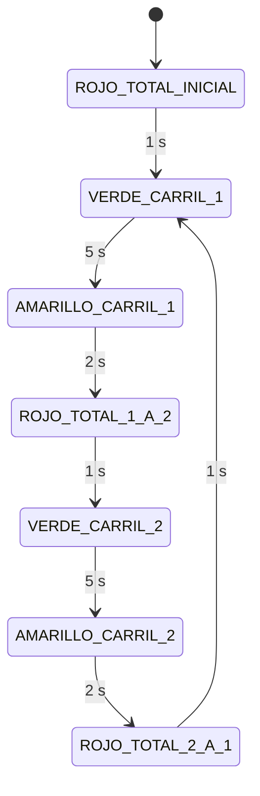

# ESP32-C6: estructura didactica, FreeRTOS y semaforos

ESP-IDF nativo v6.0.2, C, targetesp32c6.
Tarea08 consolida el firmware en seis C y cuatro cabeceras, sin cambiar el
comportamiento de fe35f06. [Guia de estudio y defensa](../GUIA_ESTUDIO.md). Tres modos Kconfig: convencional,
adaptativo simulado y adaptativo conectado. [Configurar UDP ASCII](PROTOCOLO_UDP07.md).
El modo conectado recibe conteos del PC; nunca solicita ni confirma paquetes.

## Placa y cableado provisionales

La placa exacta **no está confirmada**. Comprobar esquema y variante del chip
antes de conectar. El firmware no habilita las salidas hasta confirmar el pinout
en menuconfig, menú «Semaforos - demostracion autonoma». Sin esa opción informa
el motivo y termina la tarea; **no promete ambos rojos en ese caso**.

| Carril | Rojo | Amarillo | Verde |
| --- | --- | --- | --- |
| 1 | GPIO2 | GPIO3 | GPIO10 |
| 2 | GPIO11 | GPIO18 | GPIO19 |

Cada GPIO → resistencia individual de **330 Ω** → ánodo LED; cátodo a GND común.
LED activo alto. No compartir una sola resistencia para varios LEDs. Confirmar
tensión, polaridad y límites de corriente del chip/placa antes de energizar.

Todos los pines están en main/semaforo_gpio.h. El validador usa la macro oficial
GPIO_IS_VALID_OUTPUT_GPIO y rechaza duplicados, arranque 4/5/8/9/15, USB 12/13,
UART 16/17 y flash 24..30. Esto no prueba disponibilidad en la placa: variantes
con flash SiP pueden **no exponer GPIO10/11**, y las conexiones internas del módulo
también importan. Si no existen, elegir salidas libres según el esquema y cambiar
el encabezado; no sustituirlas por un pin reservado para conservar el ejemplo.

## Arquitectura

- main.c: constantes, auxiliares, tarea propietaria, simulador opcional y app_main.
- controlador.c/h: parametros, prioridad, estados, tiempos, seguro, recuperacion y
  aplicacion mediante operaciones inyectadas para pruebas sin hardware.
- demanda.c/h: estructuras, validacion ASCII, secuencias, duplicados, vigencia e invalidacion.
- comunicacion.c/h: STA, eventos/reconexion, estado sincronizado y receptor UDP.
- semaforo_gpio.c/h: pinout, validacion, precarga, exclusividad y aplicacion de luces.
- semaforo_gpio_idf.c: adaptador gpio_config/gpio_set_level con APIs oficiales.

Los tipos compartidos no introducen ciclos de cabeceras. La logica pura se
compila anfitriona sin FreeRTOS/SDK. Los traslados y dependencias conservadas
estan documentados en la guia de estudio. El siguiente ciclo muestra los
valores iniciales convencionales; en adaptativo cambia solo la duracion verde.



Los parámetros están centralizados en Kconfig; verdes iniciales 5000 ms, amarillo
2000 ms y rojo total 1000 ms. La tarea espera 20 ms con vTaskDelay, sin espera
activa. Consulta esp_timer_get_time y solo avanza **una fase** por actualización.
Tras aplicar GPIO fija de nuevo el inicio real de la fase: un retraso de
planificación prolonga la fase, nunca recorta amarillo/rojo para recuperar tiempo.

La revisión de GPIO conserva el rojo contrario y solo escribe niveles que cambian.
Apaga luces incompatibles, asegura primero los rojos necesarios, retira el rojo
del carril que abre y luego habilita su amarillo/verde. Las pruebas revisan cada
escritura y fallos en todas las transiciones entre estados.

Al iniciar se precargan registros con verdes/amarillos bajos y rojos altos antes
de habilitar salidas. En cada cambio se apagan primero ambos verdes, luego el
resto incompatible, y se enciende la luz deseada por carril sin quitar el rojo contrario. Hay un intervalo breve apagado
durante las escrituras; en los estados estables cada semáforo tiene exactamente
una luz y nunca ambos verdes. No hay escrituras atómicas de seis pines.

Ante fallo detectable se intentan **todas** las escrituras para apagar verdes y
amarillos y activar ambos rojos, aunque alguna falle; se bloquea el driver y se
detienen transiciones. Fallos de memoria/tareas después de habilitar GPIO también
intentan rojo seguro. Un estado lógico corrupto o reloj que retrocede pasa a
ESTADO_SEGURO. controlador_solicitar_seguro prepara una salida controlada:
verde→amarillo completo→rojo total completo→ESTADO_SEGURO. Un error GPIO usa la
acción inmediata de apagar verdes porque ya no puede confiar en las fases físicas.

El software no garantiza LEDs durante reset, arranque previo a app_main, pérdida
de alimentación, cables rotos, cortocircuitos o transistores dañados. No se desactiva
watchdog ni brownout. Esto es una maqueta educativa, con verificación física pendiente.

## Demanda y prioridad

La cola FreeRTOS conserva un solo valor. En conectado, comunicacion.c recibe y
valida; demanda.c conserva secuencia, timeout local e invalidacion retenida.
controlador.c dirige despeje, rearme y comprobacion de vigencia/generacion antes
y despues de escribir GPIO. Estas tareas
no comparten escrituras GPIO: solo main.c, el propietario, usa el driver.

D=N1-N2, umbral2, incremento2000ms, verdes5000..13000ms, amarillo2000ms y
rojo total1000ms. Alternancia obligatoria; seleccionar verde una vez al entrar,
sin extenderlo por paquetes nuevos. [Formula y escenarios](PRIORIDAD06.md).

En conectado se inicia ESTADO_SEGURO con ambos rojos. Un conteo nuevo valido
recibido desde seguro habilita rojo inicial completo y luego verde. Una
invalidacion o caducidad fuerza despeje: amarillo completo, rojo total y seguro.
Una observacion recibida durante ese despeje no permite rearmar: se necesita
otra posterior al estado seguro. Fallo GPIO bloquea y no se recupera por UDP.

Demostraciones sin red: en convencional los conteos no cambian tiempos; en
adaptativo simulado se inyectan escenarios mediante otra tarea y cola. Sin
demanda vigente usa minimo, sin fingir0/0 medidos. El simulador queda deshabilitado
en conectado. La cota nominal sin verde es19s; no aplica a permanencia en seguro.

## Compilar y programar desde VS Code

Abrir terminal con «ESP-IDF: Open ESP-IDF Terminal» y trabajar en este proyecto:

```powershell
idf.py --version
$env:IDF_TARGET = 'esp32c6'
idf.py menuconfig
idf.py build
idf.py -p COMx -b 115200 flash monitor
```

Verificar **v6.0.2** efectiva. Confirmar la placa y cableado antes de marcar
SEMAFORO_PINOUT_CONFIRMADO. Sustituir COMx por el puerto de la **C6**, que puede
diferir de la cámara. Salir del monitor con Ctrl+]. sdkconfig es local e ignorado.
No ejecutar idf.py asociado a Node/Electron: usar el terminal oficial o su Python
con el entorno IDF activado. No cambiar la instalación global para este proyecto.

## Pruebas

Ejecutar los cuatro grupos C de tests/ejecutar_host.ps1 con un compilador C99
anfitrion. tests/pruebas_controlador.c y pruebas_prioridad.c se conservan;
pruebas_udp.c cubre ASCII, secuencia, timeout, reinicio y recuperacion;
pruebas_gpio_conectado.c inyecta fallos antes/durante GPIO y verifica despejes.
Comandos y resultados en [la guia UDP](PROTOCOLO_UDP07.md).

Son simulaciones y compilaciones, sin mediciones electricas. En placa comprobar
pines, flash real de C6, polaridad, alimentacion, seis LEDs y varios ciclos. La
confirmacion de pinout usada para compilar una variante de prueba no confirma
ninguna placa ni autoriza flashearla sin revisar el esquema.

Fuentes oficiales: [GPIO y variantes C6](https://docs.espressif.com/projects/esp-idf/en/v6.0.2/esp32c6/api-reference/peripherals/gpio.html),
[FreeRTOS en ESP-IDF](https://docs.espressif.com/projects/esp-idf/en/v6.0.2/esp32c6/api-reference/system/freertos_idf.html).
